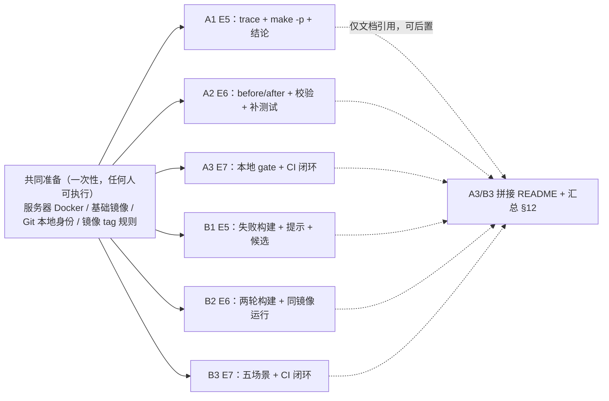

# E5–E7 论文1复现 / MVP / 验证 —— 任务分配与执行指引（A 组 3 人 / B 组 3 人）

> **本文只讲分工与判据**：谁做什么、交什么证据、什么算完成、卡住找谁。
> 具体命令、逐项检查点、常见报错对照**不在本文重复**，按课程材料执行即可：
> 三份 PPT（E5/E6/E7）、学生包 `docs/02_A轨道操作指南.md`、`docs/03_B轨道操作指南.md`、`docs/04_GitHub_CI与合并门禁.md`、`docs/05_验收清单.md`（下文简称"指南 §n"）。
> **依据**：《E5_论文1复现_20261020_讲稿优化版.pptx》《E6_论文1MVP_20261020_讲稿优化版.pptx》《E7_论文1验证_20261020_讲稿优化版.pptx》与课程原始要求（E5=复现基线、E6=MVP、E7=验证）。
> **角色延续**：A1/A2/A3、B1/B2/B3 仍是 E3/E4 的六个人员代号，本阶段按**阶段**切分，不再按"谁跑全流程"切分。
> **填表口径**：本文只写角色代号。姓名、学号、分支、镜像 tag、证据目录由本人在 §12 补填，不由他人代填。

---

## 0. E5–E7 要交付什么

E5 解释一次真实执行，E6 把它变成程序，E7 用测试与 CI 证明程序在正常和故障下都按预期工作。**每条轨道**的交付物相同，内容不同。

### 0.1 最低交付（每轨道 5 件）

1. **E5 复现说明 + 原始证据**（A：trace / Make 数据库 / 程序输出；B：失败构建日志 / 两类提示 / 模型候选与来源）
2. **E6 结构化报告 + 输入副本 + 哈希**（A：两张依赖图与 `findings.json`；B：两轮构建、`result.json`、`image_id`）
3. **E7 测试结果**（A：8 项 gate 与 `results.csv`；B：6 项 gate 与五场景目录）
4. **本人补充的一项测试** + 修改说明 + 重建镜像与运行结果
5. **CI 正常 / 失败 / 恢复记录** + main 分支保护 + 合并拒绝日志 + 最终合并记录

### 0.2 成功判据

| 轨道 | 一句话判据 |
| --- | --- |
| A | 原始样例精确得到 `MISSING(main.o, config.h)` 与 `REDUNDANT(main.o, unused.h)`；只改 Makefile 后 `findings=[]`；重复三次结果一致；三类故障按预期返回状态 |
| B | 初始构建真实到达 `RUN make` 并出现 `make: not found`；候选构建 `build=0`；**同一 `image_id`** 运行 `exit=0` 且输出 `hello E3`；五个场景全部按预期 |
| 共同 | 失败 PR 被分支保护拒绝（`BLOCKED`、普通合并退出码 1），修正后检查通过并 `MERGED`；证据路径可从报告逐条回查 |

### 0.3 本阶段的特殊约定（先讲清楚，否则组员会做多余动作）

- **A/B 共用一个仓库（已确认）**：A16 与 B16 共用 `Lilyly9/DevOps-G16`，没有第二个远程仓库；当前仓库根**还没有** `.github/workflows/`，CI 要新建在本仓库。因此 CI、分支保护、分支名、目录布局都要按"两轨道同仓"设计，见 §4.1。
- **E5/E6/E7 的脚本入口各自独立**：`lab_cloud.py e5`、`lab_cloud.py e6`、`lab_cloud.py gate` 都自己复制 fixture、自己采集、自己写到自己的 `--out` 目录，**不读别人的 work 目录**。所以三阶段互不等待：谁有空谁先做。
- **允许重复运行、允许结果不完全相同**：镜像 ID、容器 ID、`trace_id`、耗时、日志行数**本来就每人不同**。只有 §7 的判据值必须一致。
- **`work/` 默认被忽略**：个人运行不会自动进仓库提交历史。要提交的是"归档副本"（§8），不是把 `work/` 原样推上去。

---

## 1. 低耦合设计（面向"不同时间工作"）

组员**大概率不会同时在线**，所以耦合的含义变了：不再是"实时互相等"，而是"**接力时会不会被上一个人留下的状态卡住**"。
本方案的目标因此定为：**任何人在任何时间，只凭 `main` + 课程包，就能独立开工、独立交付，不需要找任何人在线。**

### 1.1 四条硬规则

| 规则 | 具体做法 | 为什么（针对异步） |
| --- | --- | --- |
| **R1 一人一阶段，端到端自证** | A1=E5-A、A2=E6-A、A3=E7-A+CI-A；B1=E5-B、B2=E6-B、B3=E7-B+CI-B | 输入是课程包，不是"上一个人什么时候有空" |
| **R2 一人一目录，一人一镜像** | 各自的克隆、各自的 `--out work/<角色>-NN`、各自的 `--image course1020-<service>:<学号>` | 上个班次留下的 `work/`、镜像 tag 不会污染你 |
| **R3 输入只来自课程包与 `main`** | 不向队友要文件、不要截图、不要"你那份 trace 发我" | 队友不在线时你也能开工 |
| **R4 仓库是唯一交接介质** | 凡"别人需要知道的"，必须写进文件（证据 `index.md`、run 记录、README 小节），不留在聊天或某人的会话里 | 异步接力只有仓库可靠；聊天记录会丢、人可能隔几天才回 |

### 1.2 唯一不变量：`main` 始终可用

异步协作没有实时协调，只能靠一条不变量兜底：**`main` 永远是可以开工的状态**。

- `main` 受分支保护，两个必需检查全绿才能合；`enforce_admins=true` 保证谁都绕不过去。
- 推论一：后开工的人**不需要问"现在能不能开工"**，`main` 就是答案。
- 推论二：**禁止** `--admin` 强合、**禁止**临时关保护、**禁止**把半成品直接推 `main`。个人工作一律走 `e5-7/<角色>-<学号>` 分支 + PR。
- 推论三：也正因为 `main` 恒绿，**路径门控从"必须"降级为"建议"**——不做门控也不会互相卡住，只是每个 PR 多跑另一条轨道的 CI（费分钟数、失败信息变多）。见 §4.1。

### 1.3 已消除的接力阻塞点（对照表）

| 看起来必须串行的点 | 常见错误做法 | 本方案做法 |
| --- | --- | --- |
| 实验包还没入库 | 自己再复制一份进去，与先到的人产生重复文件/冲突 | 开工先 `git pull`；`e5/<track>/services` 已存在就**直接用**，不存在才从课程包复制一次 |
| A1 采完 E5，A2 才能做 E6 | A2 去读 A1 的 `evidence/` | `fullcheck.py` 在 E6 里**自己**复制 fixture、`make clean`、重新 `strace`；A2 不读 A1 任何文件 |
| B1 拿到模型候选，B2 才能构建 | B2 等 B1 的候选文件 | `e6 --replay` 用包内 DeepSeek 候选，B2 随时可跑；用自己候选时也只读自己目录 |
| 上一个人构建过镜像 | 依赖 `course1020-<service>:local` 还活着 | 每人自助 `build`，自己的 tag；即使缓存被清理，重跑一次即可 |
| 上一个人的 `work/` 还在服务器上 | 复用别人留下的输出目录 | `--out` 一律用自己新建的目录；看到别人的 `work/` 不要复用 |
| 大家都要往 `tests/` 加一项测试 | 改同一个 `test_*.py` | 每人新建独立文件 `tests/test_extra_<学号>.py` |
| 共享文件撞车（README / 保护配置 / workflow） | 各自随手机改 | 只有 4 处会撞，明确所有权（§1.4） |
| 要问上一个人"这个结论怎么来的" | 依赖口头解释 | 每人证据目录必须有 `index.md`：谁、何时、命令、预期 vs 实际、如何重跑 |
| 等 E7 负责人跑完 CI 才能写报告 | 报告卡在 CI 段 | CI 段先写占位；记录由负责人提交为文件（`e7/ci/<track>/`），后来者自己读 |
| 两条轨道各自配置 main 保护 | 各自 `PUT`，后配的覆盖先配的 | `main` 只有一份保护配置；A3 起草并执行一次，B3 只读核对 |
| CI 演示分支重名 | 两条轨道都叫 `e7-gate-reject-demo` | 固定 `e7-gate-reject-demo-a` / `-b` |
| 等所有人新增测试齐了才能跑 gate | gate 里要求"必须含他人测试" | 各人 gate 只跑自己那份，结论各自成立 |

### 1.4 共享文件的所有权（以下是全部会撞的位置）

| 路径 | 所有者 | 规则 |
| --- | --- | --- |
| `.github/workflows/e7-a-quality-gate.yml` | A3 独占 | B 侧不改 |
| `.github/workflows/e7-b-quality-gate.yml` | B3 独占 | A 侧不改 |
| `e7/ci/main-protection.json` | A3 起草并执行 `PUT` 一次；B3 只读核对 | 任何人不重复 `PUT`，避免互相覆盖 |
| `e5/README.md`、`e6/README.md`、`e7/README.md` | 全组 | 每个阶段一份；只追加自己那节；冲突时保留双方 |
| `<阶段>/evidence/<角色>-<学号>/`、`<阶段>/reports/<角色>-<学号>.md`（E5→`e5/`、E6→`e6/`、E7→`e7/`） | 本人独占 | 不代填、不改他人 |
| `e5/<track>/services/**`、`scripts/**`、`fixtures/**` | 该轨道全员共用 | 只追加 `tests/test_extra_<学号>.py`；A3/B3 的 CI 演示测试也用固定名 `test_ci_reject_demo.py`；不删改他人文件 |

### 1.5 开工三步 / 收工三件

**开工（每次，必做）**

1. `git switch main && git pull --ff-only`；长期分支先 `git rebase origin/main`（用 rebase，不用 merge，避免历史分叉）。
2. 看 `e5/<track>/services` 是否已存在：**存在就用，不要再复制课程包**。
3. `doctor` + `build` 自己的镜像。**环境状态可能已经变了**（Docker 服务重启、基础镜像被清理、`gh` token 被覆盖），不要假设上个班次的环境还在。

**收工（每次，必做）**

1. 证据归档到本阶段的 `evidence/<角色>-<学号>/`（E5→`e5/`、E6→`e6/`、E7→`e7/`），并写 `index.md`（谁/何时/命令/预期 vs 实际/如何重跑）。
2. 关键判据值写进本阶段 `README.md` 自己那节。
3. push 分支 + 开 PR，PR 描述写清"只改了哪些路径、关键判据是什么"，让下一个班次的人不用问你。

### 1.6 允许的"资源串行"

- 偶然撞上同时构建时，不要并行开两个 `build`/`gate`；等 3–5 分钟换新目录重试即可。
- 网络失败（`auth.docker.io`、拉镜像超时）先确认日志**是否已到达 `RUN make`**，再决定重跑还是报助教；不要把网络故障记成"功能失败"。

### 1.7 开工前自检（6 问，全"是"才开工）

1. 我先 `pull` 了吗？分支是否已 rebase 到最新 `main`？（是）
2. 实验包已存在时，我是否**没有再复制一份**？（是）
3. 我的输入是否只有课程包 + 我自己的学号？（是）
4. 我的命令是否只写我自己的 `--out` 与 `--image`？（是）
5. 我卡住时能否自己定位（日志 + 新目录重跑），而不是等人回消息？（是）
6. 我提交的文件是否只在我的目录（含共享文件的既定小节）？（是）

---

## 2. 角色与任务包总表

| 角色 | 阶段 | 核心交付 | 完成判据（详见 §7.1） |
| --- | --- | --- | --- |
| **A1** | E5-A 复现 | `work/e5-<A1>-01/evidence/`：`trace/`、`make-db.txt`、`program-output.txt`；复现说明 | 输出 `1`；声明含 `unused.h`；trace 有成功读取 `config.h`；结论与证据行号对应 |
| **A2** | E6-A MVP | `work/e6-before-<A2>/`、`work/e6-after-<A2>/`、`verify_e6_evidence.py` 输出；补充测试 | 前后 findings 精确 2 → 0；仅 `Makefile` 哈希变化；新测试通过且重建镜像成功 |
| **A3** | E7-A + CI-A | `gate-result.json`、`results.csv`；CI 正常/失败/恢复三份记录 | 8 项 `passed=true`、gate 退出码 0；失败 PR `BLOCKED`；恢复后 `MERGED` |
| **B1** | E5-B 复现 | `iter-01/`（失败日志、`result-retry.json`、两类提示、`error-localization.json`）、`work/candidate/`、候选来源记录 | `build_exit_code=1`、`make: not found`、脚本退出码 0；候选（自选或包内）构建成功并运行输出 `hello E3` |
| **B2** | E6-B MVP | `work/e6-<B2>-replay/`（两轮构建、`result.json`、`image_id`、`verify.log`）、`verify_e6_b_evidence.py` 输出；补充测试 | 第一轮 `MISSING_MAKE`、第二轮 `build=0`、同一 `image_id` 运行 `exit=0`、`output_matches=true` |
| **B3** | E7-B + CI-B | `gate-result.json`、`results.csv`、五场景目录；CI 正常/失败/恢复三份记录 | 6 项 `passed=true`、gate 退出码 0；超时容器已清理；失败 PR `BLOCKED`；恢复后 `MERGED` |

---

## 3. 阶段与依赖关系



- 六条泳道**没有先后要求**：可以同时开工，也可以相隔几天各自开工；每条泳道的起点只有 `main` + 课程包。
- 实线是"共同准备"，但它对每人都是**可自查、可自助**的环境动作，不是"等人交付"。
- 虚线是**收口动作**，最后统一做；任何一条虚线没完成，都不影响其它泳道的证据成立。

---

## 4. 开工前准备（每人、每次开工都做）

由于组员不同时在线，设备/缓存/登录态都可能在两次班次之间变化，**每次开工都要重新确认**，不要假设上个班次的状态还在。

| 项 | 内容 | 说明 |
| --- | --- | --- |
| 同步 | `git switch main` → `git pull --ff-only`；自己的长期分支先 `git rebase origin/main` | 不同步就开工会把过时状态当现状，且 PR 会因 `strict=true` 被要求更新 |
| 仓库 | 唯一仓库 `https://github.com/Lilyly9/DevOps-G16.git`（A16+B16 共用，已核实） | 不要另建仓库、不要 `git init` 子目录 |
| 克隆目录 | 各自的 `~/<学号>/DevOps-G16`，不要共用同一个工作副本 | 服务器是共用的；共用副本会互相看到对方未提交的改动 |
| 环境 | 进入本组云服务器（Linux），确认 `docker` 免 sudo、`python3`、`git`、`gh` 可用 | `lab_cloud.py` 在非 Linux 上直接报错退出，Windows 只用来写报告 |
| 基础镜像 | 预拉取 Python 与 `build-essential` 相关基础镜像 | 网络失败先修网络，不要在失败日志上做判断 |
| 实验包 | 看 `e5/<track>/services` 是否已存在：**存在就直接用**；不存在才从课程包复制一次到 `e5/A-buildchecker/`、`e5/B-draft/` | A 包由 A 侧首个动手的人入库，B 包由 B 侧首个动手的人入库，互不依赖；包内若带 `.git` 先删掉 |
| Git 身份 | `git config --local user.name "<学号>"`、`git config --local user.email "<邮箱>"` | **只用 `--local`**；服务器的 Git 账号是共用的 |
| 镜像 tag | 统一规则 `course1020-<service>:<学号>`（A=`buildchecker`，B=`draft`） | 默认 tag 是 `:local`，六个人会互相覆盖，必须改 |
| 目录 | 每人确认自己的 `--out` 命名：`work/<阶段>-<角色>-<序号>` | `--out` 必须位于 `work/` 之下且为空目录，否则脚本直接拒绝 |

> **共享账号警告**：`gh auth login` 的凭据按操作系统用户保存，多人共用同一登录账号会**互相覆盖 token**。因此 **CI 相关命令只由 A3 / B3 执行**；每次跑 CI 前先 `gh auth status` 确认登录态仍有效，失效就重新登录。这是本阶段唯一需要"指定执行人"的动作，但它**不阻塞**其他人的 E5/E6 工作。

### 4.1 共用仓库的落地结构（已核实）

```text
DevOps-G16/                        # 唯一仓库：A16 + B16
├── .github/workflows/
│   ├── e7-a-quality-gate.yml      # job name 必须叫 e7-a-quality-gate
│   └── e7-b-quality-gate.yml      # job name 必须叫 e7-b-quality-gate
├── e5/                            # 阶段 1：实验包代码 + E5 证据
│   ├── A-buildchecker/            # A 实验包（唯一一份代码）
│   ├── B-draft/                   # B 实验包（唯一一份代码）
│   ├── evidence/ reports/
│   └── README.md
├── e6/                            # 阶段 2：只放 E6 证据与报告
│   ├── evidence/ reports/
│   └── README.md
├── e7/                            # 阶段 3：只放 E7 证据、报告与 CI 记录
│   ├── evidence/ reports/ ci/
│   └── README.md
├── e3/  e4/  contracts/  docs/    # 已有阶段
```

**工作流必须做的三处改造**（A3/B3 各自改自己那份）：

| 改造 | A 轨道写法 | 说明 |
| --- | --- | --- |
| 工作目录 | `defaults.run.working-directory: e5/A-buildchecker` | 实验包不在仓库根，`scripts/`、`services/` 都相对它 |
| 构建上下文 | `docker build -f services/buildchecker/Dockerfile -t e7-buildchecker:ci .` | `.` 已由工作目录决定，不要写成仓库根 |
| 产物路径 | `e5/A-buildchecker/work/ci/` | artifact 上传目录 |

**路径门控（建议做，不做也能异步协作）**

- 为什么是"建议"而不是"必须"：既然 `main` 恒绿（§1.2），不做门控也只会让每个 PR 多跑另一条轨道的 CI（费分钟、日志更长），**不会卡住任何人**。
- 做了的好处：只跑本轨道，PR 反馈更快、失败信息更干净。
- 做法：两个 workflow 都监听 `push` / `pull_request`，checkout 后用 `git diff --name-only` 判断是否涉及 `e5/A-buildchecker/**`（B 同理），不涉及就让实质步骤全部跳过；被跳过的 job 必须以 **success** 结束（不是 `Expected`/`pending`）。验收方法：开一个只改 `e6/reports/**` 的 PR，确认**两个**必需检查都变绿。
- 若门控实现不了，直接让两个 workflow 全量跑并在 README 写明即可，不影响分工。

> 实验包内自带的 `labs/*/.github/workflows/e7-quality-gate.yml` 放到子目录后**不会被执行**（GitHub 只读仓库根的 `.github/workflows/`），保留仅作参考，不要误以为它在生效。

---

## 5. A 组任务明细

> 执行目录：`e5/A-buildchecker`（A 实验包在本仓库中的位置）。下文 `<A1>` 等替换为**自己的角色代号**，`<学号>` 替换为本人学号。

### A1｜E5-A：复现原始证据与结论

| 步骤 | 做什么 | 交付 |
| --- | --- | --- |
| A1-1 | 按 §4 设本地身份；`python3 scripts/lab_cloud.py doctor` | `doctor` 输出无 FAIL |
| A1-2 | 构建服务镜像（自己的 tag）：`python3 scripts/lab_cloud.py build --out work/build-A1-01 --image course1020-buildchecker:<学号> --build-timeout 1200` | `work/build-A1-01/unit-tests/`，**15 passed** |
| A1-3 | 采集 E5：`python3 scripts/lab_cloud.py e5 --out work/e5-A1-01 --image course1020-buildchecker:<学号>` | `work/e5-A1-01/evidence/`：`trace/t.*`、`make-db.txt`、`program-output.txt`、`build-stderr.log` |
| A1-4 | 读输出：`cat .../program-output.txt`；`grep -n '^main.o:' .../make-db.txt`；`grep -n 'config.h' .../trace/t.*` | 输出 `1`；声明 `main.o: main.c unused.h`；trace 有成功 `openat(... "config.h" ...)` |
| A1-5 | 写结论：目标 `main.o`、实际依赖（`main.c`、`config.h`）、声明依赖（`main.c`、`unused.h`）、MD=`config.h`、RD=`unused.h`，并填**本次真实 trace 文件与行号**、进程归属（`cc1`←`cc`←`make`，同任务的 `as` 写出 `main.o`） | 复现说明（写入本人报告） |
| A1-6 | 写"与论文步骤的对照"：论文用 ptrace 跟踪器 / 本实验用 `strace -ff -s 4096 -e trace=%file,%process`；论文读构建声明 / 本实验用 `make -p` 数据库；输入是已知答案的小样例 | 对照表（三行即可） |
| A1-7 | 归档：把 `work/e5-A1-01/evidence/` 复制到 `e5/evidence/A1-<学号>/`；trace 只留关键文件 + 一份 `trace-index.md` 说明 | 归档目录 |

**A1 必须说得出**：为什么"clean build 成功"不能证明声明正确（`config.h` 存在，编译器按 `#include` 自行找到）；RD 为什么会导致多余重编译。

### A2｜E6-A：自动检测、修复复检、补充测试

| 步骤 | 做什么 | 交付 |
| --- | --- | --- |
| A2-1 | 设本地身份；`doctor`；构建自己的镜像：`build --out work/build-A2-01 --image course1020-buildchecker:<学号>` | 15 passed |
| A2-2 | 原始检测：`python3 scripts/lab_cloud.py e6 --out work/e6-before-A2 --image course1020-buildchecker:<学号>` | 入口退出码 **1**（`--fail-on-findings`）；`findings.json`：`status=SUCCEEDED`、`build_exit_code=0`、两条错误 |
| A2-3 | 修复复检：`python3 scripts/lab_cloud.py e6 --fixed --out work/e6-after-A2 --image course1020-buildchecker:<学号>` | 退出码 **0**，`findings=[]`；`--fixed` **只改独立副本**，`fixtures/` 不动 |
| A2-4 | 校验：`python3 scripts/verify_e6_evidence.py --before .../e6-before-A2/evidence/findings.json --after .../e6-after-A2/evidence/findings.json` | `passed: true`、`changed_inputs: ["Makefile"]` |
| A2-5 | 读码：在 `services/buildchecker/buildchecker/fullcheck.py` 找出"进程归属"和"路径过滤"两段实现，各写 3–5 行说明 | 说明写入本人报告 |
| A2-6 | 补充一项测试：新建 `services/buildchecker/tests/test_extra_<学号>.py`（**独立文件，不要改别人的测试**），输入与预期都写清 | 测试文件 + 修改说明 |
| A2-7 | 重建镜像 + 自跑 gate：`build --out work/build-A2-02 ...`（测试数应变为 16+）→ `python3 scripts/lab_cloud.py gate --out work/e7-A2-selfcheck --image course1020-buildchecker:<学号>` | gate 退出码 0，证明新测试已进入门禁 |
| A2-8 | 归档 `work/e6-before-A2/`、`work/e6-after-A2/`、校验输出、`work/e7-A2-selfcheck/gate/` | `e6/evidence/A2-<学号>/` |

**注意**：A2-7 的 gate 是**自己的**自证运行，与 A3 的正式 gate 各跑各的，结果不共享、不比对，也不要求任何一方等待另一方。

### A3｜E7-A + CI-A：门禁、失败拦截与恢复

| 步骤 | 做什么 | 交付 |
| --- | --- | --- |
| A3-1 | 设本地身份；`doctor`；构建镜像 | 15 passed（若 A2 的补充测试已合入，则为 16+，以实际为准） |
| A3-2 | 独立判定测试：`python3 -m unittest discover -s tests/e7 -v` | **6 tests OK** |
| A3-3 | 完整门禁：`python3 scripts/lab_cloud.py gate --out work/e7-A3-01 --image course1020-buildchecker:<学号>` | 退出码 **0**；`gate/gate-result.json` 八项 `passed=true`；`results.csv` 八行 |
| A3-4 | 逐项核对八项：服务单测、原始三次（错误集合每次相同、各有 `trace_id`）、修复后（`findings=[]`、仅 Makefile 变化）、构建失败（`FAILED`/1）、多输出（`UNSUPPORTED`）、超时（`TIMED_OUT`） | 场景核对表（写入报告） |
| A3-5 | 新建根级 `e7-a-quality-gate.yml`（按 §4.1 三处改造 + 路径门控），推送到 `DevOps-G16`；`gh run list` → `gh run watch` | `CI_EXIT_CODE=0`；A run 服务测试通过；artifact 含 `e5/A-buildchecker/work/ci/commit.txt` |
| A3-6 | main 保护：先 `gh api .../check-runs` 核对 App ID，再由 **A3 起草并执行一次** `PUT`，提交 `e7/ci/main-protection.json`（同时含两个必需检查）。B3 只读核对，不重复 `PUT` | 两个必需检查、`strict=true`、`enforce_admins=true`、审批 0 |
| A3-7 | 失败 PR：分支 `e7-gate-reject-demo-a`（**必须带 `-a`**），只复制 `e5/A-buildchecker/ci/rejection-demo/A/test_ci_reject_demo.py` | A run `1 failed / 15 passed`；B 检查为 **success（被门控跳过）**；PR `BLOCKED`；普通合并退出码 **1** |
| A3-8 | 恢复：换成同目录 `fixed/` 的同名测试后 push | A run `16 passed`；PR `CLEAN` → `MERGED`，保存 `mergeCommit`、`mergedAt` |
| A3-9 | 归档：run URL、artifact、`protection.json`、`PR.json`、`merge-rejection.log`、`PR-merged.json` | `e7/ci/A/` |

> A3-7/A3-8 只改 `tests/` 里的一个演示测试文件，**不要**用"改算法"冒充"改预期"；报告中必须写明"本次恢复修正的是测试预期，不是实现"。

---

## 6. B 组任务明细

> 执行目录：`e5/B-draft`（B 实验包在本仓库中的位置）。

### B1｜E5-B：真实失败、提示与模型候选

| 步骤 | 做什么 | 交付 |
| --- | --- | --- |
| B1-1 | 设本地身份；`doctor` | 无 FAIL |
| B1-2 | 构建自己的镜像：`build --out work/build-B1-01 --image course1020-draft:<学号> --build-timeout 1200` | `unit-tests/`，**24 passed** |
| B1-3 | 采集 E5：`python3 scripts/lab_cloud.py e5 --out work/e5-B1-01 --image course1020-draft:<学号> --build-timeout 600` | `iter-01/`：`Dockerfile`、`build-retry.log`、`result-retry.json`、`error-localization.json`、`prompt-error-driven.txt`、`prompt-context-driven.txt` |
| B1-4 | 核对真实失败：`build_exit_code=1`、日志含 `make: not found`、脚本自身退出码 **0**（两层退出码含义不同，要能解释） | 核对结论 |
| B1-5 | 候选：把两类提示**全文**发给对话模型，`work/candidate/model-response.txt` 存原始回复，`work/candidate/Dockerfile` 去掉代码围栏 | 候选 + 原始回复 |
| B1-6 | 来源记录：填 `templates/候选来源记录.json` 副本（模型/版本/日期/提示类型/选择理由/候选哈希） | 来源记录 |
| B1-7 | 手工复建与运行：按 E5/27 页命令 `docker build --progress=plain -f work/candidate/Dockerfile -t course1020-draft-e5:<学号> work/e5-B1-01/project`，再 `docker run --rm --network none <image_id>` | `BUILD_EXIT_CODE=0`、`VERIFY_EXIT_CODE=0`、输出 `hello E3` |
| B1-8 | 归档到 `e5/evidence/B1-<学号>/`（含候选与来源记录） | 归档目录 |

**降级路径（不阻塞任何人）**：如果暂时拿不到模型回复，可先用包内候选 `fixtures/ci-candidates/DeepSeek-E5.Dockerfile` 完成 B1-7，并在来源记录中注明 `REPLAY_SUPPLIED`；后续补自己的候选，不影响 B2/B3 开工。

### B2｜E6-B：两轮构建与同镜像运行验证

| 步骤 | 做什么 | 交付 |
| --- | --- | --- |
| B2-1 | 设本地身份；`doctor`；构建自己的镜像 | 24 passed |
| B2-2 | 自动构建（**默认用包内候选，零等待**）：`python3 scripts/lab_cloud.py e6 --replay --out work/e6-B2-replay --image course1020-draft:<学号> --build-timeout 600` | `evidence/result.json`：`status=SUCCEEDED` |
| B2-3 | 校验：`python3 scripts/verify_e6_b_evidence.py --run-dir work/e6-B2-replay/evidence` | `passed: true`、`baseline_failure=MISSING_MAKE`、`fixed_build_exit_code=0`、`verify_exit_code=0`、`verified_output=hello E3` |
| B2-4 | 自行核对五项：iter-01 `MISSING_MAKE`、iter-02 `build=0`、`image_id` 与运行参数一致、`verify.log` 为 `hello E3`、`input_sha256` 与 `project/` 实际一致 | 核对表（写入报告） |
| B2-5 | 读码：在 `services/draft/draft/autobuild.py` 找出 `prepare_candidate()` 与镜像运行限制（`--network none`、资源限制）各写 3–5 行说明 | 说明写入报告 |
| B2-6 | 补充一项测试：新建 `services/draft/tests/test_extra_<学号>.py`（独立文件），输入与预期写清 | 测试文件 + 修改说明 |
| B2-7 | 重建镜像 + 自跑 gate：`build --out work/build-B2-02 ...`（24→25+）→ `gate --replay --out work/e7-B2-selfcheck --build-timeout 600` | gate 退出码 0 |
| B2-8 | 归档 `e6-B2-replay/`、校验输出、`e7-B2-selfcheck/gate/` | `e6/evidence/B2-<学号>/` |

> 也可用自己 E5 的候选：`--candidate work/candidate/Dockerfile`。两条路线只影响"候选来源"，不影响判据；**不要因为等 B1 的候选而不开工**。

### B3｜E7-B + CI-B：五场景、超时清理与合并门禁

| 步骤 | 做什么 | 交付 |
| --- | --- | --- |
| B3-1 | 设本地身份；`doctor`；构建镜像 | 24 passed（含他人补充测试则更多，以实际为准） |
| B3-2 | 完整门禁：`python3 scripts/lab_cloud.py gate --replay --out work/e7-B3-01 --image course1020-draft:<学号> --build-timeout 600` | 退出码 **0**；`gate-result.json` 六项 `passed=true`；`results.csv` 六行 |
| B3-3 | 五场景逐项核对：正常候选、输出不符、无效候选（构建前拒绝、`attempts` 为空）、候选构建失败（第二轮 `build=1` 且停止运行验证）、运行超时（`delay=10` / 预算 1s / `TIMED_OUT`） | 场景核对表 |
| B3-4 | 清理证据：`runtime-timeout/` 下的 `verify-container-id.txt` 对应容器**已不存在**；`fault-injection.json` 显示两个 Dockerfile 同步改 CMD，项目源文件未变 | 清理核对结论 |
| B3-5 | 新建根级 `e7-b-quality-gate.yml`（按 §4.1 三处改造 + 路径门控），推送到 `DevOps-G16` | run `24 passed`、`CI_EXIT_CODE=0`；artifact 在 `e5/B-draft/work/ci/` |
| B3-6 | main 保护：与 A3 共用**同一份** `e7/ci/main-protection.json`；不重复 `PUT`，只核对 `gh api .../protection` 与预期一致 | 两个必需检查齐全、`strict`、`enforce_admins`、审批 0 |
| B3-7 | 失败 PR：分支 `e7-gate-reject-demo-b`（**必须带 `-b`**），只复制 `e5/B-draft/ci/rejection-demo/B/test_ci_reject_demo.py` | B run `1 failed / 24 passed`；A 检查为 **success（被门控跳过）**；PR `BLOCKED`；合并退出码 **1** |
| B3-8 | 恢复：换同目录 `fixed/` 同名测试 | run `25 passed`；`MERGED`，保存 `mergeCommit`、`mergedAt` |
| B3-9 | 归档 `e7/ci/B/` | CI 证据目录 |

---

## 7. 完成判据（DoD）

### 7.1 逐角色门槛值（每人自己那份证据都要满足）

| 角色 | 环境/镜像 | 关键判据 |
| --- | --- | --- |
| A1 | `doctor` 无 FAIL；镜像 tag 含本人学号 | 程序输出 `1`；`make-db.txt` 有 `main.o: main.c unused.h`；`trace/t.*` 有成功 `openat` `config.h`；结论写明 trace 文件与行号、进程归属 |
| A2 | 同上 | before：`status=SUCCEEDED`、`build_exit_code=0`、findings 恰为 `MISSING(main.o,config.h)` + `REDUNDANT(main.o,unused.h)`、入口退出码 1；after：`findings=[]`、退出码 0；校验脚本 `passed=true` 且 `changed_inputs=["Makefile"]`；新测试通过且重建成功 |
| A3 | 同上 | `tests/e7` 6 tests OK；gate 退出码 0；八项 `passed=true`；CI 三份记录齐全且 PR 最终 `MERGED` |
| B1 | `doctor` 无 FAIL；镜像 tag 含本人学号 | `build_exit_code=1`；`build-retry.log` 含 `make: not found`；采集脚本退出码 0；候选 + 原始回复 + 来源记录齐全；候选构建 0 且运行 `hello E3` |
| B2 | 同上 | `status=SUCCEEDED`；iter-01 `MISSING_MAKE` 且 `build≠0`；iter-02 `build=0`；运行 `image_id` 与第二轮一致、`exit=0`、`output_matches=true`；校验脚本 `passed=true`；新测试通过 |
| B3 | 同上 | gate 退出码 0；六项 `passed=true`；超时容器已清理；CI 三份记录齐全且 PR 最终 `MERGED` |

### 7.2 证据清单（对照 `templates/验收记录.csv`）

- [ ] `C01 环境`：云主机、Docker、实际工具版本、Git 本地身份
- [ ] `C02 E5`：原始证据 + 与论文步骤差异说明
- [ ] `C03 E6`：输入副本、哈希、JSON 报告、原始日志
- [ ] `C04 E7`：**本人补充的一项测试** + 修改说明 + 运行结果
- [ ] `C05 CI`：正常 / 失败 / 恢复三份 run 与 artifact
- [ ] `C06 CI`：必需检查配置 + 实际拒绝合并日志 + 最终合并记录
- [ ] `A01`：MD/RD 精确证据与修复前后哈希
- [ ] `A02`：原始三次一致 + 三类故障场景
- [ ] `B01`：缺失 make 与候选来源
- [ ] `B02`：两轮构建与同镜像运行
- [ ] `B03`：五场景与超时清理

---

## 8. 证据目录与命名规范

顶层按阶段分文件夹（与 `e3/`、`e4/` 一致）：**实验包代码只在 `e5/` 放一份**，`e6/`、`e7/` 只放本阶段证据与报告。`work/` 不提交（实验包自带 `.gitignore` 已忽略 `work/`、`.env`、`*.pem`、`*.key`）。

```text
e5/                               # 阶段 1：代码 + E5 证据
  README.md
  A-buildchecker/                 # A 实验包（唯一一份）
  B-draft/                        # B 实验包（唯一一份）
  evidence/A1-<学号>/             # index.md + trace 关键文件 + make-db.txt + program-output.txt
  evidence/B1-<学号>/             # iter-01 关键日志 + 两类提示 + 候选 + 来源记录
  reports/A1-<学号>.md
  reports/B1-<学号>.md
e6/                               # 阶段 2：只放 E6 证据与报告
  README.md
  evidence/A2-<学号>/             # index.md + before/after + verify 输出 + 自证 gate + 单测日志
  evidence/B2-<学号>/             # result.json + 两轮构建摘要 + verify.log + image_id
  reports/A2-<学号>.md
  reports/B2-<学号>.md
e7/                               # 阶段 3：只放 E7 证据、报告与 CI 记录
  README.md
  evidence/A3-<学号>/             # gate-result.json + results.csv + 故障场景摘要
  evidence/B3-<学号>/             # gate-result.json + results.csv + 五场景摘要 + 清理结论
  reports/A3-<学号>.md
  reports/B3-<学号>.md
  ci/
    main-protection.json          # 唯一一份：两个必需检查都在里面
    A/                            # runs、artifact、protection 回读、merge-rejection.log、PR-merged.json
    B/
```

**为什么代码只在 `e5/`**：E5/E6/E7 用的是同一份实验包。若每个阶段各放副本，A2 在 E6 新增的测试就不会出现在 E7 的 gate 与 CI 里（三份副本必然分叉）。E6/E7 执行前先 `cd ../e5/<track>`。

**每个证据目录必须有 `index.md`**（异步交接的核心：后来者不问人也能读懂）

| 必填项 | 内容 |
| --- | --- |
| 谁 / 何时 | 角色、学号、运行时间（UTC 更佳）、服务器与工具版本 |
| 命令 | 完整命令（含 `--out`、`--image`），能整段重跑 |
| 预期 vs 实际 | 关键字段与退出码；差异及原因 |
| 证据清单 | 目录内每个文件是什么、看哪个字段 |
| 重跑方法 | 从 `main` 出发的最小步骤；需要的新 `--out` 名 |

**命名纪律**

- 每人只写自己的 `evidence/<角色>-<学号>/` 与 `reports/<角色>-<学号>.md`，**不代填他人目录**。
- 分支：`e5-7/<角色>-<学号>`；CI 演示分支固定为 `e7-gate-reject-demo-a` / `e7-gate-reject-demo-b`。
- 提交前缀 `feat(e5-7):`、`test(e5-7):`、`docs(e5-7):`、`fix(e5-7):`。
- **不要**把任何目录命名为 `env/`：根 `.gitignore` 有 `env/` 规则，E3 曾因此需要 `git add -f` 才能提交 `e3/env/`。
- 大体积原始 trace 不入库：保留关键 `t.*` + `trace-index.md`（说明原始路径、总文件数、如何重采）。
- 日志带版本信息：`e6-before-<角色>.log`、`e6-after-<角色>.log`、`gate-<角色>.json`。

---

## 9. 纪律与红线

| 项 | 要求 |
| --- | --- |
| 开工同步 | 每次开工先 `git pull --ff-only`；长期分支 `rebase` 到 `origin/main`；不要基于几天前的 `main` 开工 |
| 不重复入库 | 实验包已存在于 `main` 时**直接复用**，不要再次复制同一批文件（会产生重复文件或冲突） |
| 交接介质 | 只用仓库交接：结论、路径、run ID 都写进 `index.md` / README / `e7/ci/`；**不要**依赖聊天发文件或口头解释 |
| 环境复核 | 不假设上个班次的状态：`docker info`、基础镜像、`gh auth status` 每次重查 |
| Git 身份 | **只用 `--local`**；登录账号是共用的，`--global` 会把提交作者变成别人 |
| 镜像 | 一律 `--image course1020-<service>:<学号>`；默认 `:local` 会互相覆盖 |
| 输出目录 | `--out` 必须在 `work/` 下且为空；每次重跑用**新目录**，保留上一次证据 |
| 不并发构建 | 同一台机器不同时开第二个 `build`/`gate`；撞车等 3–5 分钟换目录重试 |
| 不进仓库 | `.env`、Token、SSH 私钥、模型 API Key、GitHub 登录文件、完整 trace 大包 |
| 不造假 | 网络/环境故障与"目标故障"分开记录；不要把超时/网络失败写成功能通过 |
| CI 凭据 | `gh auth login` 只在 A3/B3 执行；若两人用不同 GitHub 账号，先设 `GH_CONFIG_DIR=~/.config/gh-<学号>` 再登录，否则 token 互相覆盖 |
| 分支保护 | main 保护只有**一份**配置；A3/B3 约定一人执行 `PUT`，另一人只读核对，避免互相覆盖 |
| 分支重名 | CI 演示分支必须带 `-a`/`-b`；同仓两条轨道不允许共用分支名 |
| 断线 | SSH 断开后重新登录看日志与进程，**不能只凭断线判断成功或失败** |
| 报告口径 | CI 记录、测试数量以**文件**形式提交（`e7/ci/<track>/`、`results.csv`），后来者自读；不需要等人回复 |

---

## 10. 交接抽查（以文件为准，不需要同时在线）

抽查只在仓库里进行，随时可做，**不设到齐**：

1. 从报告里挑一条结论，沿证据路径能否找到原始日志与行号/`trace_id`/`image_id`？
2. 每个 `evidence/<角色>-<学号>/` 是否有合格的 `index.md`（命令能整段重跑）？
3. `evidence/` 里的人工预期与真实输出是否分得开（有无 `provenance` 或说明）？
4. 三个 gate 的 `passed=true` 是否都有对应 `results.csv` 行？
5. CI 失败 PR 的检查名是否与 main 保护里的必需检查一致？

结论由 A3 与 B3 汇总到 §12，发现的问题**退回本人修改**（异步处理即可），检查人不代改。

---

## 11. 风险与待确认项

| 项 | 说明 | 处理 |
| --- | --- | --- |
| A/B 共用一个仓库（已确认） | `Lilyly9/DevOps-G16` 是唯一仓库（A16+B16），当前**没有** `.github/workflows/`，CI 需新建 | 按 §4.1 落地：两个根级 workflow、`working-directory` 指向各实验包、保护配置只应用一份 |
| 不同时工作 → 状态过期 | 两次班次之间 Docker 被重启、镜像被清理、`gh` token 被覆盖、`main` 已前进 | 每次开工走 §4 的同步与环境复核；不要假设旧会话状态 |
| 时间跨度长 → 构建漂移 | 基础镜像按 digest 固定，但 `apt-get` 包与 `pip` 版本不固定，隔几天构建结果可能不同 | 报告里记录实际版本与日期；对比结论时说明"版本不同"而不是"功能失败" |
| 路径门控做不对 | 被跳过的 job 若停在 `Expected`，PR 无法合并 | 验收用例：只改 `e6/reports/**` 的 PR，两个必需检查都应变绿；做不到就退回"全量跑"（`main` 恒绿时不会卡人） |
| 分支长期不更新 | `strict=true` 要求分支与 `main` 同步，过时分支合不了 | 开工先 `rebase origin/main`；不要攒很久再提 PR |
| 两个 workflow 文件重名 | 实验包内都叫 `e7-quality-gate.yml`，根目录不能并存 | 根级改为 `e7-a-quality-gate.yml` / `e7-b-quality-gate.yml`，**job name** 保持 `e7-a-quality-gate` / `e7-b-quality-gate` 以匹配课程保护配置 |
| 私有仓库分支保护 403 | 免费私有仓库无法配置保护 | 经本人同意后改为公开仓库（课程已注明） |
| App ID 15368 不符 | 保护配置里的 App ID 需与实际 check-runs 一致 | 先 `gh api .../check-runs` 核对，再改 JSON |
| 网络与镜像源 | `auth.docker.io`、基础镜像拉取失败常见 | 先确认日志是否已到 `RUN make`；不要在网络失败上做功能判断 |
| B 构建网络 | 构建服务用 `bridge`，最终程序验证用 `--network none` | 不要改成"全程禁网"，会卡在依赖安装层 |
| 模型候选来源 | 可自选模型或使用包内 `--replay` | 报告与来源记录必须写清；`--replay` 不得描述成"本次模型生成" |
| 测试数量变化 | 每人各补一项测试，最终数量会大于课程的 15/24 与 16/25 | README 写**实际**数量，报告中说明"本人新增了哪一项" |
| 资源不足 | 内存/CPU 偏低会放大构建超时 | 记录实际值；影响构建时降并发、报助教 |

---

## 12. 记录表（本人填写）

| 角色 | 姓名 | 学号 | 分支 | 服务镜像 tag | 关键证据目录 | E7/CI 结论 | 本人补充说明 |
| --- | --- | --- | --- | --- | --- | --- | --- |
| A1 | 待补 | | `e5-7/A1-<学号>` | `course1020-buildchecker:<学号>` | `e5/evidence/A1-<学号>/` | — | |
| A2 | 万宇 | 241880496 | `e5-7/A2-241880496` | `course1020-buildchecker:241880496` | `e6/evidence/A2-241880496/` | gate（自证）退出码 **0**，8/8 `passed=true` | 新增 `test_extra_241880496.py`（2 项）；本地 WSL2 运行；报告 `e6/reports/A2-241880496.md` |
| A3 | 待补 | | `e5-7/A3-<学号>` | 同上 | `e7/evidence/A3-<学号>/`、`e7/ci/A/` | 8 项全 passed；失败 PR：；恢复 run： | |
| B1 | 待补 | | `e5-7/B1-<学号>` | `course1020-draft:<学号>` | `e5/evidence/B1-<学号>/` | — | 候选来源：自己 / `REPLAY_SUPPLIED` |
| B2 | 待补 | | `e5-7/B2-<学号>` | 同上 | `e6/evidence/B2-<学号>/` | gate（自证）退出码： | 新增测试文件： |
| B3 | 待补 | | `e5-7/B3-<学号>` | 同上 | `e7/evidence/B3-<学号>/`、`e7/ci/B/` | 6 项全 passed；失败 PR：；恢复 run： | |

**E5–E7 结束时每人应能一句话说清**：我负责的阶段、我的证据目录、我的关键判据值、以及"我没有等任何人"的依据（我用的是课程包 + 自己的学号）。

---

*本文件为 E5–E7 任务分配与执行指引；命令细节一律以课程 PPT 与学生包 docs 为准。随进展由 A3 与 B3 共同更新，姓名/学号/分支/镜像 tag 由本人补填。*
